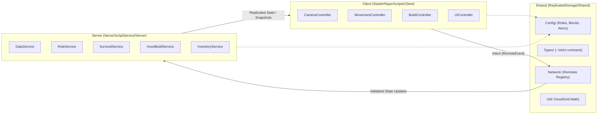

# VoxelRealms — Technical Architecture

> **Status:** Living Document — update this file whenever you add or modify a Service, Controller, Config, or Remote.

## 1. High-Level Topology

---

## 2. Deterministic Boot Lifecycle
Both `src/server/init.server.luau` and `src/client/init.client.luau` boot modules in two explicit phases:
1. **`Init()` Phase:** Register remotes, initialize local tables, bind internal references. Must NOT yield or rely on another module's runtime state.
2. **`Start()` Phase:** Connect Roblox events (`PlayerAdded`, `Heartbeat`, input bindings), begin game loops, and safely call other Services/Controllers.

This eliminates race conditions even as the team grows to dozens of modules.

---

## 3. Domain Ownership Map (Multi-Developer Scaling)
Each developer or AI agent can own a specific domain folder with minimal overlap:

| Domain | Server Path | Client Path | Shared Dependencies |
| :--- | :--- | :--- | :--- |
| **Data & Persistence** | `src/server/Services/DataService` | — | `Types/PlayerTypes` |
| **Roleplay Roles** | `src/server/Services/RoleService` | `src/client/Controllers/UIController` | `Config/Roles`, `Network/Remotes` |
| **Survival Stats** | `src/server/Services/SurvivalService` | `src/client/Controllers/UIController` | `Types/SurvivalTypes`, `Network/Remotes` |
| **Voxel Building** | `src/server/Services/VoxelBuildService` | `src/client/Controllers/BuildController` | `Config/Blocks`, `Util/VoxelGrid`, `Network/Remotes` |
| **Camera & Movement** | — (anti-cheat checks later) | `CameraController`, `MovementController` | `Config/Constants` |
| **Inventory & Crafting** | `src/server/Services/InventoryService` | `src/client/Controllers/UIController` | `Config/Items`, `Config/Recipes`, `Network/Remotes` |
| **World & Gathering** | `src/server/Services/WorldService` | `src/client/Controllers/GatherController` | `Config/ResourceNodes`, `Network/Remotes` |
| **Day/Night & Campfires** | `src/server/Services/AtmosphereService` | `src/client/Controllers/UIController` | `Config/Constants`, `Workspace` attributes |
| **Creatures & AI** | `src/server/Services/CreatureService` | — (replicated models & HP bars) | `Config/Creatures`, `Config/Items` |
| **Action Combat** | `src/server/Services/CombatService` | `src/client/Controllers/CombatController` | `Config/Constants`, `Network/Remotes` |

---

## 4. Network Registry (`src/shared/Network/Remotes.luau`)
All Client ↔ Server communication goes through `ReplicatedStorage.Remotes` managed by `src/shared/Network/Remotes.luau`.

| Remote Name | Direction | Purpose |
| :--- | :--- | :--- |
| `SelectRole` | Client → Server | Request switching/selecting a Role ID |
| `RoleUpdated` | Server → Client | Broadcast confirmed Role state to players |
| `PlaceVoxel` | Client → Server | Request placing a voxel block at a grid coordinate |
| `RemoveVoxel` | Client → Server | Request breaking/removing a voxel block at a grid coordinate |
| `SurvivalStateChanged` | Server → Client | Sync authoritative Health/Stamina/Hunger snapshot |
| `SetSprinting` | Client → Server | Toggle authoritative sprint state (drains stamina & applies role move speed) |
| `RequestDodge` | Client → Server | Request dodge dash stamina deduction with server cooldown validation |
| `InventoryUpdated` | Server → Client | Sync authoritative `InventoryMap` snapshot to the player |
| `GatherNode` | Client → Server | Request striking/harvesting a voxel resource node (`nodeId`) |
| `CraftRecipe` | Client → Server | Request crafting a recipe ID (validates ingredients & Role requirements) |
| `UseItem` | Client → Server | Request consuming a survival item (`berry`, `healing_tonic`, `campfire_kit`) |
| `ToastNotification` | Server → Client | Display feedback toast message in the client HUD |
| `RequestAttack` | Client → Server | Request stamina-checked melee strike along aim vector |
| `CombatFeedback` | Server → Client | Replicate hit position & damage amount for floating damage numbers |

*(Add every new remote here as it is implemented.)*

---

## 5. Voxel Grid Standard (`src/shared/Util/VoxelGrid.luau`)
- `VOXEL_SIZE_STUDS = 4` (`4×4×4` studs per block).
- World positions snap cleanly to integer grid coordinates `(gx, gy, gz)` via `VoxelGrid.worldToGrid(pos)` and `VoxelGrid.gridToWorld(gridPos)`.
- Placed blocks are keyed by string `"gx,gy,gz"` on the server (`VoxelBuildService`) for $O(1)$ lookup, collision validation, ownership checks, and delta persistence.

---

## 6. Cloud Persistence (`src/server/Services/DataService/init.luau`)
- **Store:** `DataStoreService:GetDataStore("VoxelRealms_PlayerData_v1")`, keyed by `"player_<UserId>"`.
- **Schema (`PlayerProfile` v1):** `roleId`, sanitized `inventory`, `health`, and `hunger`.
- **Safety:** Uses `UpdateAsync` with up to 3 retry attempts, 120-second background autosave for dirty profiles, immediate save on `PlayerRemoving`, and `game:BindToClose` shutdown flush.
- **Studio Offline Fallback:** When running an unpublished local `.rbxl` shell in Roblox Studio without Studio API Services enabled, `DataService` automatically falls back to clean in-memory session profiles so local testing never errors.
